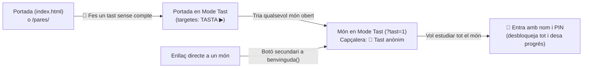

# Pla d'especificació · Mode Tast Anònim («Tasta un món sense compte»)

## 1. Objectiu i per a qui és

Permetre que qualsevol persona (**pares i mares**, docents, companys nous o un alumne que vol tafanejar abans de crear-se el perfil) pugui **entrar i tastar una mostra real de qualsevol món obert sense escriure cap nom ni cap PIN**, amb tres garanties absolutes:

1. **100 % anònim i invisible al rànquing:** no surt cap nom ni cap estrella a cap pestanya del rànquing (`Estrelles`, `Dies`, `Nivell`, `Setmana`, `Remuntada`, `Xat`) ni al tauler `/admin/`.
2. **Zero escriptura a Supabase i zero petjada a l'aparell:** no crida cap RPC d'usuari, no envia res a `bn_log`, i **no ocupa cap dels 2 noms màxims per dispositiu** (`MAX_NOMS = 2` a `localStorage`).
3. **Tast suficient per entendre l'eina, limitat per no substituir l'estudi amb perfil:** deixa provar el flux real (fitxa + targetes + test curt amb explicacions + 1 joc de mostra), però manté la resta del món reservada a entrar amb `nom + PIN`.

> [!IMPORTANT]
> Avui moltes famílies que arriben a `bonanota.net` o a `/pares/` no poden veure com és un món per dins sense inventar-se un nom fals, cosa que embrutaria `bn_log`, `bn_priv.perfils` i el rànquing. El **Mode Tast Anònim** resol això d'arrel.

---

## 2. Com s'hi entra i com es veu (UX)

### Tres portes d'entrada naturals (sense carregar la pantalla)
1. **A la portada (`index.html`, sota el botó `Entra ▶` d'`#entrada`):**
   - Botó secundari discret: `👀 Fes un tast sense compte (anònim)`.
   - També, si un visitant sense sessió toca una targeta de món bloquejada (`main.bloc`), en lloc de només sacsejar el formulari de nom/PIN, li ofereix allà mateix una drecera clicable: *«Escriu el teu nom i PIN per guardar el progrés, o **fes un tast anònim →**»*.
   - Quan el Mode Tast està actiu a la portada, `#hola` mostra una barra clara:
     `👀 Mode tast anònim · Cap dada ni estrella es guarda ni surt al rànquing · [🔐 Entra amb nom i PIN] [✕ Surt del tast]`
     i el botó de cada targeta oberta diu **`TASTA ▶`** (respectant igualment els mons tancats `🔒 TANCAT` per l'admin).
2. **Dins de cada món (`benvinguda()` a `motor/plantilla-estudi-interactiu.html`):**
   - Sota `Entra ▶`, un botó secundari: `👀 Tasta aquest món sense compte`.
3. **Des de la guia de famílies (`pares/index.html`):**
   - Botó directe a la capçalera i al final: `👀 Tasta un món per dins (sense registrar-te)` → porta a `../?tast=1#mons`.

---

## 3. Què es pot fer i quines limitacions té el Mode Tast

L'equilibri ideal és **«1 tema sencer de mostra + 1 joc de mostra»** a cada món: prou ric perquè s'entengui la qualitat pedagògica de Bona Nota en 2 minuts, però prou acotat perquè estudiar de debò es faci sempre amb `nom + PIN`.

| Apartat / Funció | En Mode Tast Anònim (`MODE_TAST`) | Amb `nom + PIN` |
|---|---|---|
| **Visió del temari del món** | Es veuen **tots els títols dels temes** (per veure què entra a l'examen), però només el **Tema 1** té l'etiqueta `👀 Mostra oberta`; els Temes `2…N` porten `🔒 Amb nom i PIN` | Tots els temes oberts |
| **📖 Fitxa resum i 🃏 Targetes** | **Obertes al Tema 1** (senceres, amb àudio/efectes i girs) | Obertes a tots els temes |
| **✅ Test del tema** | **1 test curt de mostra al Tema 1 (5 preguntes)** amb correcció immediata i explicació del *per què* | Tests complets a tots els temes + rècords |
| **🎮 Jocs interactius** | **El 1r joc del món obert en mode mostra** (1 partida curta / límit de 5 rondes); la resta de jocs i el **👾 Boss del món** es mostren amb descripció i `🔒` | Tots els jocs + Boss del món |
| **✍️ Preguntes obertes** | Es deixa **llegir la 1a pregunta oberta i les pistes** com a mostra; l'enviament i la **📷 Foto del quadern** (`bn-corregeix`) queden bloquejats amb avís (protegeix també la quota d'IA) | Totes les obertes + Triple Combo + Foto del quadern |
| **📝 Exàmens, 🔁 Repàs, 🎯 Missions, 📊 Com vaig** | Desactivats (vista breu explicant per a què serveixen quan s'entra amb perfil) | Complets i sincronitzats al núvol |
| **⭐ Estrelles i 🏆 Rànquing** | Capçalera fixa **`👀 Tast anònim · sense rànquing`**. No s'acumulen al rànquing ni al perfil; el rànquing de portada només es pot mirar en lectura | Suma estrelles, puja de nivell i surt al rànquing |
| **💬 Xat de la colla i 👾 Perfil arcade** | Pot **veure** com és el xat (només lectura), però **no pot escriure-hi, ni votar «Ben dit», ni desar perfil arcade** | Complet (amb crèdits d'estudi) |
| **📅 «Demà tinc examen»** | Ocult en Mode Tast (no té sentit sense perfil ni data pròpia) | Actiu (fins a 2 dies per món) |

### Com es demana passar a compte real (sense pressió ni FOMO)
Quan l'usuari acaba el test de mostra de 5 preguntes o toca un element amb `🔒`, s'obre una targeta amable (o modal lleuger):
- **Missatge positiu (seguint `docs/BON-US.md` §1.3, sense «perdràs les estrelles!»):**
  > *«👀 Fins aquí arriba el tast d'aquest món! Per obrir tots els temes, els jocs, el repàs dels errors i desar el teu progrés, entra amb el teu nom i un PIN de 4 números i 1 lletra.»*
- Dos botons clars: **`🔐 Entra amb nom i PIN`** (porta a `benvinguda()` / `#entrada` desactivant el tast) i **`Continua mirant el tast`**.

---

## 4. Arquitectura tècnica i blindatge de privadesa (3 capes)

Per garantir que **mai** cap sessió anònima pugui aparèixer al rànquing, a `bn_log`, ni bloquejar el límit de `MAX_NOMS = 2` d'un mòbil familiar:

### Capa 1 · Estat efímer només a `sessionStorage` i memòria (mai a `localStorage`)
- Clau única de sessió de pestanya: `sessionStorage.getItem("bn_tast") === "1"` o paràmetre d'URL `?tast=1` (que activa `sessionStorage.setItem("bn_tast", "1")` mentre no hi hagi ja un `bn_jugador` actiu amb PIN; o bé un botó explícit commuta al tast sense esborrar els perfils locals de germans!).
- **Regla d'or a `localStorage`:** quan `MODE_TAST` és `true`:
  - **NO** s'escriu a `localStorage.bn_jugador`.
  - **NO** s'escriu a `localStorage.bn_noms_aparell` (`apuntaNom()` retorna immediatament → no gasta mai cap dels 2 llocs de l'aparell!).
  - **NO** s'escriu a `localStorage["bn_<mon>_perfils"]` (`guarda()` escriu només en memòria o a `sessionStorage["bn_tast_" + CL]`, que s'esborra sol en tancar la pestanya).
  - Si en aquell dispositiu ja hi jugava un nen i algú activa «Surt / Fes un tast», els perfils i PINs guardats dels nens de casa queden intactes.

### Capa 2 · Tallafoc de xarxa al client (`SENSE_USUARI`)
- A `motor/plantilla-estudi-interactiu.html`:
  - `const MODE_TAST = ...` (separat de `MODE_DEMO`, que és per a proves internes `?demo` i tests automàtics!).
  - `registra(event, detall)` retorna immediatament si `MODE_TAST` és actiu → **0 insercions a `public.bn_log`**.
  - `buidaTemps()`, `nuvolPuja()`, `nuvolBaixa()`, `sincronitzaEntrada()`, `carregaPuntsMons()` retornen immediatament si `MODE_TAST` és actiu → **0 crides a `bn_progres_*`, `bn_perfil_*`, `bn_punts_maxim`**.
  - `enviaFotoQuadern()` bloquejat abans de tocar la càmera o `bn-corregeix`.
  - **Sí que es permeten les 2 crides públiques de lectura sense nom:** `bn_estat_web` (per respectar si l'admin ha tancat un món!) i `bn_vigilia` (sense efectes personals).
- A `index.html`:
  - Si `tastActiu()` i no hi ha `jugador()`, el panell del xat mostra el missatge de lectura (`👀 En mode tast no es pot escriure al xat`) i bloqueja `bn_xat_envia` i `bn_xat_vota`.
- A `perfil/index.html`:
  - Si s'hi entra sense `bn_jugador` (en mode tast), mostra una previsualització o redirigeix amablement a crear `nom + PIN` abans de desar a `bn_aspecte_desa`.

### Capa 3 · Xarxa de seguretat al servidor (`supabase/bn_ranking_net.sql`)
- Encara que el client mai enviï res en `MODE_TAST`, afegim a `bn_priv.nom_prohibit(t)` (3 línies idempotents) els identificadors reservats `^(_.*|tast|convidat|anonim|guest|demo_tast)$` perquè ni tan sols una petició manipulada pugui inserir un usuari anònim a `public.bn_log` o fer-lo aparèixer al rànquing.

---

## 5. Filtre de bon ús (`docs/BON-US.md` §6)

Tota mecànica nova a Bona Nota ha de passar les 10 preguntes de `docs/BON-US.md`:

| Pregunta del filtre (`BON-US.md` §6) | Com ho compleix el Mode Tast | Complert |
|---|---|---|
| 1. Premia aprendre i no pas estar-hi més estona? | Mostra la fitxa, les targetes i l'explicació de cada pregunta; no premia minuts | Sí |
| 2. Té topall al dia? | Sí: acotat a Tema 1 (5 preguntes) + 1 joc de mostra, sense estrelles persistents | Sí |
| 3. Si el nen no entra un dia, perd alguna cosa? | No hi ha ratxes ni avisos de pèrdua; tampoc fem xantatge emocional («perdràs les estrelles!») en convidar a crear el PIN | Sí |
| 4. El premi depèn de l'atzar? | No | Sí |
| 5. Fa sentir malament qui va darrere? | No participa al rànquing ni es compara amb ningú | Sí |
| 6. Funciona en mode suau i sense so? | Sí: respecta el botó de so, `prefers-reduced-motion` i la franja nocturna | Sí |
| 7. Respecta el descans i la franja de nit? | Sí: el mode suau nocturn i el descans continuen actius | Sí |
| 8. Té en compte la fase del món? | Respecta `mons_tancats` de l'admin; amaga «Demà tinc examen» perquè és anònim | Sí |
| 9. Guarda només el mínim i sense text lliure? | Guarda **zero** al servidor i **zero** a `localStorage` | Sí |
| 10. El pare la pot entendre i provar? | És precisament l'eina ideal perquè les famílies provin Bona Nota des de `/pares/` | Sí |

---

## 6. Pla d'implementació per fases (1 sol PR net, ~150 línies)

1. **`motor/plantilla-estudi-interactiu.html`**
   - Definir `MODE_TAST` (`usp.get("tast") === "1"` o `sessionStorage.getItem("bn_tast") === "1"` quan no s'entra amb jugador registrat) i funció `activaTast()` / `surtTast()`.
   - Tallar `registra()`, `guarda()` cap a `localStorage`, `apuntaNom()` i totes les RPC d'usuari quan `MODE_TAST` és actiu.
   - Pintar la insígnia superior `👀 Tast anònim` + botó `🔐 Entra amb PIN` a la barra del món.
   - A `pintaTemes()`: Tema `0` obert amb etiqueta `👀 Mostra`; Temes `1..N-1` visibles amb `🔒` que obren el diàleg amable `convidaPin()`.
   - A `test()` del Tema `0`: limitar a `5` preguntes en `MODE_TAST` i, al resum final, mostrar la targeta `convidaPin()`.
   - A `pintaJocs()`: primer joc obert (`👀 Mostra`), resta de jocs i Boss amb `🔒` → `convidaPin()`.
   - A `obertes()`: mostrar la 1a pregunta en lectura i substituir «Comprova / Foto del quadern» per `convidaPin()`.
   - Afegir prova automàtica `bnProvaModeTast` a `window.BN_PROVES` (verifica 0 escriptures a `localStorage.bn_noms_aparell`, 0 crides de xarxa d'usuari, bloqueig del Tema 2 i desbloqueig del Tema 1 amb 5 preguntes).
2. **`index.html` i `pares/index.html`**
   - Botó `👀 Fes un tast sense compte` sota `#entrada` i estat `#hola` de Mode Tast (`TASTA ▶` a les targetes obertes, propaga `?tast=1`).
   - Enllaç `👀 Tasta un món per dins` a `pares/index.html`.
   - Bloqueig d'escriptura/vot al xat si `tastActiu()`.
3. **`supabase/bn_ranking_net.sql` (opcional, defensa en profunditat)**
   - Reservar `tast`, `convidat`, `anonim` i prefix `_` a `bn_priv.nom_prohibit`.
4. **Proves Playwright (`motor/prova-tast.js` + integració a `.github/workflows/revisa.yml`)**
   - Comprova des d'`index.html` → Mode Tast → món → Tema 1 (5 preguntes) → Tema 2 bloquejat → **0 crides RPC d'escriptura / `bn_log`** → `bn_noms_aparell` buit → clic a `🔐 Entra amb nom i PIN` retorna netament a l'entrada normal.

---

## 7. Decisions ràpides per confirmar abans de programar-ho

Tot el pla té valors per defecte recomanats; digues-me si et semblen bé o si vols ajustar-ne algun:
1. **Abast del tast a cada món:** **Tema 1 complet (fitxa + targetes + test de 5 preguntes) + 1r joc del món + vista de la 1a oberta**, i la resta amb `🔒`. Et quadra aquest límit?
2. **Enllaç des de `/pares/`:** hi afegim també el botó *«👀 Tasta un món per dins (sense registrar-te)»* perquè els pares ho puguin provar d'un clic?
